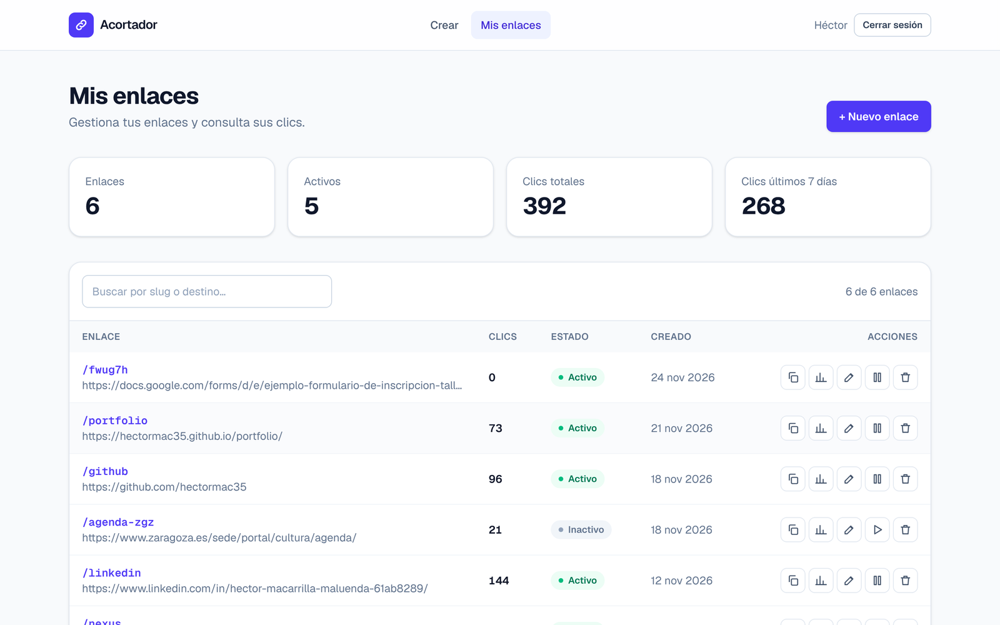
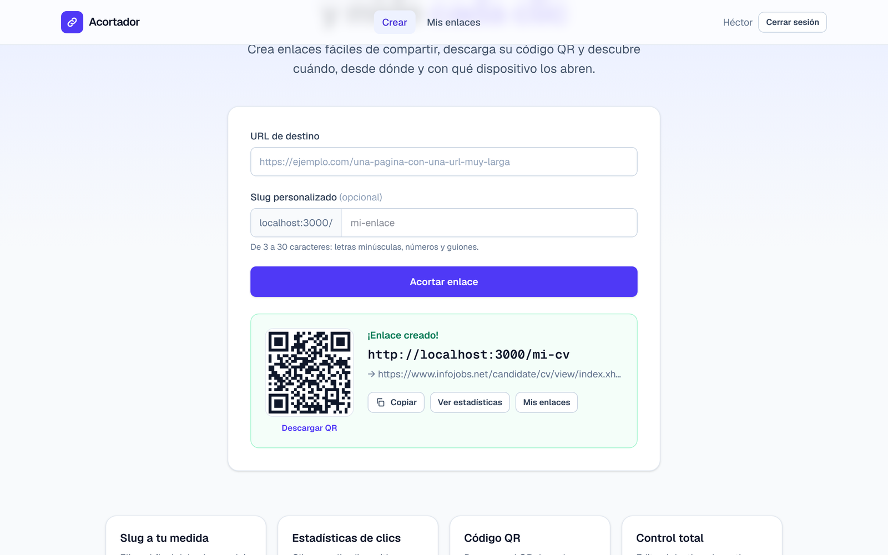
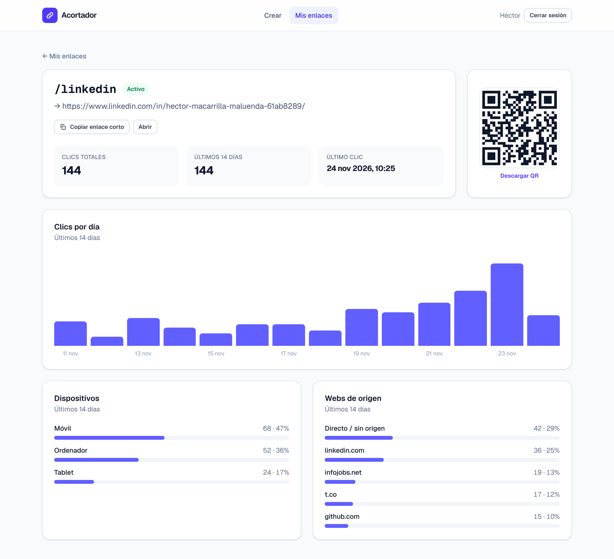
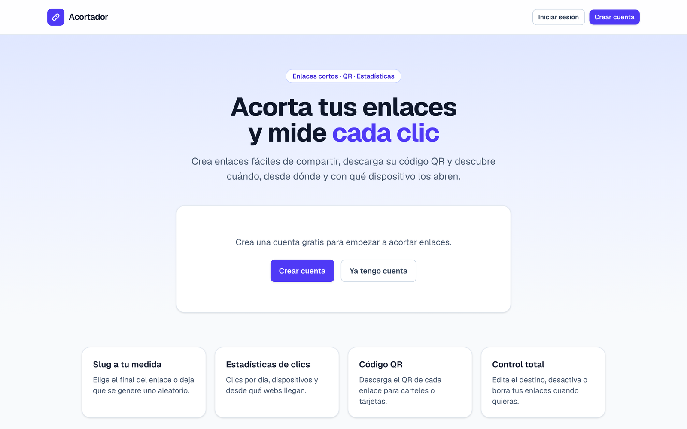
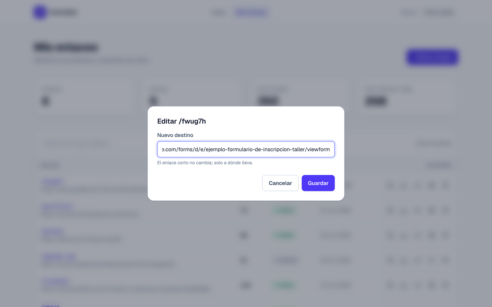
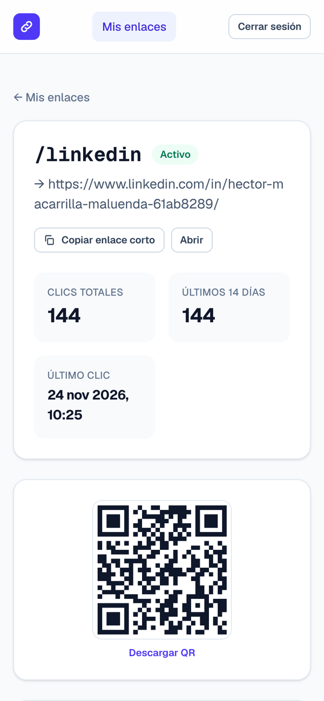

# 🔗 Acortador de URLs

Aplicación web para **acortar enlaces**, compartirlos con un **código QR** y medir **cada clic**:
cuándo se abre, desde qué dispositivo y desde qué web llega la visita. Cada persona tiene su cuenta
y gestiona únicamente sus propios enlaces.

Proyecto personal de portfolio hecho con **Next.js 16, TypeScript, Prisma y PostgreSQL**.



## ✨ Funcionalidades

- **Cuentas de usuario** con email y contraseña (NextAuth + bcrypt).
- **Enlaces cortos** con slug personalizado o aleatorio.
- **Código QR** de cada enlace, descargable en PNG.
- **Estadísticas por enlace**: clics por día de las últimas dos semanas, dispositivos (móvil, ordenador, tablet o bot) y webs de origen.
- **Panel «Mis enlaces»** con resumen (enlaces, activos, clics totales y de la última semana), buscador, edición del destino, activar/desactivar y borrado con confirmación.
- **Página 404 propia** para enlaces que no existen o están desactivados.
- Diseño adaptado a móvil.

| Crear un enlace | Estadísticas |
|---|---|
|  |  |

| Inicio | Editar destino | Móvil |
|---|---|---|
|  |  |  |

## 🔐 Seguridad

- **Cada usuario solo ve y modifica sus enlaces**: el panel, las estadísticas y la API filtran por el usuario de la sesión. Si alguien intenta acceder a un enlace ajeno recibe un `404`, así ni siquiera sabe que existe.
- **Solo destinos `http(s)`**: se rechazan `javascript:`, `data:`, `file:`… para que un enlace corto no pueda usarse para ejecutar código.
- **Slugs reservados** (`login`, `dashboard`, `api`…) para que ningún enlace tape una página de la app.
- **Contraseñas** con bcrypt (coste 12), mínimo 8 caracteres y email normalizado.
- **Login sin filtrar emails**: se tarda lo mismo exista o no el email, así no se puede averiguar quién tiene cuenta.
- **Sin carreras al crear**: los duplicados los detecta la restricción `UNIQUE` de la base de datos, no un «comprobar y luego insertar».
- **Privacidad en las estadísticas**: no se guardan IPs; de la web de origen solo se guarda el dominio.
- **Cabeceras de seguridad** (`X-Frame-Options`, `X-Content-Type-Options`, `Referrer-Policy`, `Permissions-Policy`).

## 🛠️ Tecnologías

| | |
|---|---|
| Frontend y backend | Next.js 16 (App Router), React 19, TypeScript |
| Estilos | Tailwind CSS 4 |
| Autenticación | NextAuth.js (credenciales) + bcrypt |
| Datos | Prisma ORM + PostgreSQL (Neon en producción) |
| Validación | Zod |
| Tests | Vitest |
| Calidad y despliegue | ESLint, GitHub Actions, Docker |

## 📁 Estructura

```
app/
├── page.tsx                 # Inicio: crear enlaces
├── [slug]/page.tsx          # Redirección + registro del clic
├── dashboard/page.tsx       # Mis enlaces (resumen + tabla)
├── dashboard/[id]/page.tsx  # Estadísticas de un enlace
├── api/urls/…               # API REST: crear, listar, editar y borrar
├── api/register/route.ts    # Registro
└── components/              # Cabecera, QR, copiar, avisos…
lib/
├── validation.ts            # Esquemas Zod, slugs reservados, generador de slugs
├── analytics.ts             # Dispositivo, dominio de origen, clics por día
├── auth.ts · session.ts     # NextAuth y usuario actual
└── prisma.ts
tests/                       # Tests unitarios (Vitest)
```

## 🚀 Puesta en marcha

### En local

Requisitos: Node.js 20+ y una base de datos PostgreSQL (local, Docker o [Neon](https://neon.tech)).

```bash
git clone https://github.com/hectormac35/acortador-de-urls.git
cd acortador-de-urls
cp .env.example .env          # rellena DATABASE_URL y NEXTAUTH_SECRET
npm install
npx prisma migrate deploy     # crea las tablas
npm run dev                   # http://localhost:3000
```

### Con Docker

```bash
docker compose up --build     # http://localhost:3001
```

Levanta PostgreSQL y la aplicación en modo producción. Las migraciones se aplican solas al arrancar.

## 🧪 Calidad

```bash
npm test            # tests unitarios
npm run lint        # ESLint
npm run typecheck   # TypeScript
npm run build       # build de producción
```

GitHub Actions ejecuta todo esto en cada push y comprueba que la imagen Docker se construye.

## 🔌 API

Todas las rutas requieren sesión.

| Método | Ruta | Descripción |
|---|---|---|
| `GET` | `/api/urls` | Enlaces del usuario con su número de clics |
| `POST` | `/api/urls` | Crear (`{ target, slug? }`) → `201`, `400` o `409` si el slug está ocupado |
| `PATCH` | `/api/urls/:id` | Cambiar `target` y/o `active` |
| `DELETE` | `/api/urls/:id` | Borrar el enlace y sus clics |
